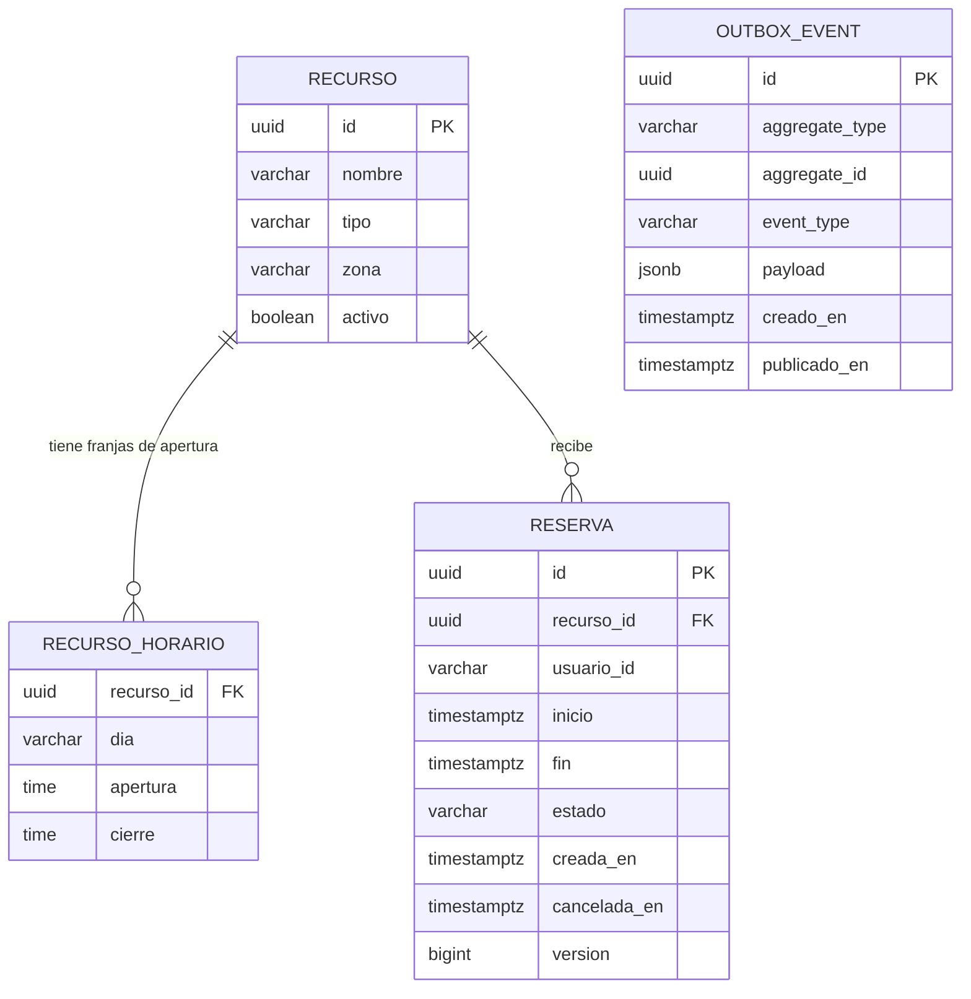
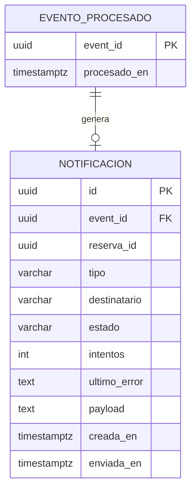

# ReservaRecursosPublica

Plataforma de reservas de recursos públicos municipales (pistas deportivas, salas, instalaciones). Proyecto de portfolio para GitHub y CV, orientado a demostrar más que dominio de Java: arquitectura por capas, mensajería, seguridad, testing serio, CI/CD y observabilidad.

Autor: Toni, desarrollador backend Java (Spring Boot/MVC, Spring Security, Oracle, Maven, Git, Linux Debian) con experiencia en sector público. Objetivo del proyecto: reforzar el perfil para puestos backend Java remotos y avanzar hacia DevOps.

## Stack y versiones

| Elemento | Valor |
|---|---|
| Java | 21 (instalado en el IDE; no subir a 25 salvo decisión explícita registrada en un ADR) |
| Spring Boot | 4.1.x (parent `spring-boot-starter-parent`) |
| Spring Cloud BOM | 2025.1.2 (compatible con Boot 4.1.x; si falla la comprobación de compatibilidad, ajustar aquí) |
| Build | Apache Maven, multi-módulo |
| Base de datos | PostgreSQL (migraciones con Flyway) |
| Mensajería | Apache Kafka |
| Seguridad | Keycloak (OAuth2/OIDC, JWT, roles) |
| Documentación API | springdoc-openapi 3.x (rama para Boot 4) |
| Tests | JUnit 5, Mockito, AssertJ, Testcontainers 2.x, ArchUnit, JaCoCo |
| CI/CD | GitHub Actions, imágenes Docker multietapa (`eclipse-temurin:21-jre`) |
| Observabilidad | Actuator, Micrometer, Prometheus, Grafana |
| Front-end | Angular (última versión estable al empezar la fase 7; se fija en un ADR), TypeScript estricto, Angular Material, `keycloak-angular`; Node LTS |
| Tests front | Runner por defecto de la CLI de Angular (unitarios), Playwright (e2e) |

IDE: IntelliJ IDEA Ultimate. Se trabaja desde la terminal integrada con Claude Code.

## Módulos Maven

Proyecto padre `reserva-recursos-publica` (packaging `pom`, sin código, sin `src`):

| Módulo | Responsabilidad |
|---|---|
| `common` | Solo contratos compartidos: eventos y constantes. Sin lógica de negocio, sin plugin `spring-boot-maven-plugin`. |
| `reservas-service` | Núcleo: recursos, reservas, reglas de negocio, API REST, outbox. |
| `notificaciones-service` | Consume eventos de Kafka y envía correos; idempotente. |
| `api-gateway` | Entrada única: enrutado, validación JWT, filtros transversales. |

`frontend/` (Angular) vive en el mismo repositorio pero **no es un módulo Maven**: se construye con npm/Node y no entra en `mvn verify`. Tiene su propio job en el CI.

Paquete base: `io.github.<usuario>.reservas.<servicio>`.

## Arquitectura interna de cada servicio

Tres capas: `domain`, `application`, `infrastructure`.
Regla de dependencias: `domain` no importa Spring web, Kafka ni infraestructura (JPA anotado en el dominio está permitido por pragmatismo). Esta regla se verifica con un test ArchUnit en cada servicio.

### common

```
event/   ReservaEvent (sealed interface), ReservaCreada, ReservaCancelada (records), Topics
web/     ErrorCodes (opcional)
```

### reservas-service

```
domain/model/       Recurso, Reserva (aggregate root, @Version), FranjaHoraria (record @Embeddable),
                    HorarioApertura (value object puro, SIN anotaciones JPA: Recurso persiste sus franjas
                    como @ElementCollection, ver ADR 0002), FranjaApertura (record @Embeddable),
                    EstadoReserva (CONFIRMADA, CANCELADA), TipoRecurso (PISTA, SALA, INSTALACION)
domain/policy/      PoliticaCancelacion (antelación mínima, p. ej. 24 h)
domain/exception/   ReservaSolapadaException, RecursoNoDisponibleException,
                    CancelacionNoPermitidaException, FueraDeHorarioException,
                    RecursoNoEncontradoException, ReservaNoEncontradaException
application/        ReservaService, RecursoService,
                    command/ (CrearReservaCommand, CancelarReservaCommand, CrearRecursoCommand),
                    port/EventPublisher
infrastructure/web/         ReservaController, RecursoController, dto/ (records),
                            mapper/ (ReservaMapper, RecursoMapper),
                            GlobalExceptionHandler (@RestControllerAdvice → ProblemDetail)
infrastructure/persistence/ ReservaRepository, RecursoRepository
infrastructure/messaging/   OutboxEvent (record, no entidad JPA), OutboxRepository (JdbcClient + SQL explícito),
                            OutboxEventPublisher, OutboxRelay (@Scheduled: publica y purga)
infrastructure/config/      SecurityConfig, KafkaConfig, OpenApiConfig, ClockConfig
resources/db/migration/     V1__esquema.sql, V2__outbox.sql
```

### notificaciones-service

```
domain/             Notificacion, EstadoNotificacion (PENDIENTE, ENVIADA, FALLIDA), TipoNotificacion,
                    EventoProcesado (eventId)
application/        NotificacionService, port/NotificationSender
infrastructure/messaging/   ReservaEventListener (@KafkaListener), KafkaConsumerConfig (reintentos + DLT),
                            NotificacionReintentos (@Scheduled: reintenta pendientes y fallidas)
infrastructure/mail/        MailNotificationSender, PlantillaCorreo
infrastructure/persistence/ NotificacionRepository, EventoProcesadoRepository
infrastructure/config/      ClockConfig
```

### api-gateway

```
config/   RoutesConfig (RouterFunction), SecurityConfig, CorsConfig
filter/   CorrelationIdFilter (X-Correlation-Id), RequestLoggingFilter
```

### frontend (Angular)

```
frontend/
  src/app/
    core/       auth/ (keycloak-angular, interceptor Bearer, guards por rol)
                api/  (cliente generado desde OpenAPI: NO se edita a mano)
                error/ (traducción de ProblemDetail a mensajes de usuario)
    features/   recursos/   (listado y detalle, selector de franja)
                reservas/   (nueva reserva, mis reservas, cancelar)
                gestion/    (alta/edición de recursos: solo gestor y admin)
    shared/     componentes y pipes reutilizables (p. ej. pipe de franja en la zona del recurso)
  Dockerfile    multietapa: node (build) → nginx (servir estáticos)
  nginx.conf
```

El front habla **siempre con el `api-gateway`**, nunca directamente con `reservas-service`.

## Reglas de dominio clave

- `FranjaHoraria(inicio, fin)`: `inicio < fin`; método `solapaCon(otra)`. Franjas contiguas NO se solapan.
- `Reserva` guarda `Instant` (UTC). El horario de apertura se interpreta en la zona del recurso (`Europe/Madrid` por defecto).
- `HorarioApertura.permite(franja, zona)`: la reserva no cruza medianoche y cae dentro de una `FranjaApertura` del día correspondiente.
- `Recurso.validarReserva(franja)`: comprueba que está activo y que el horario lo permite.
- `Reserva.cancelar(Clock, PoliticaCancelacion)`: la lógica vive en la entidad (dominio no anémico). Siempre con `Clock` inyectado para tests deterministas.
- Anti-solapamiento entre reservas distintas del mismo recurso: `@Version` NO basta (son filas distintas). Decidido (ADR 0001): restricción de exclusión en PostgreSQL como garantía real, más una consulta previa (`existeSolapada`) para dar un error de negocio claro.
- No existe tabla de usuarios: el `usuarioId` sale del claim `sub` del JWT.
- Escritura de eventos: patrón Outbox. `ReservaService` guarda reserva y `OutboxEvent` en la misma transacción (el puerto `EventPublisher` exige transacción: `MANDATORY`); `OutboxRelay` publica a Kafka con `FOR UPDATE SKIP LOCKED`, en orden y al menos una vez. Un solo topic (`reservas.eventos`), clave del mensaje = id de la reserva, tipo en la cabecera `eventType`.
- Notificaciones: el evento se registra en `evento_procesado` con `INSERT ... ON CONFLICT DO NOTHING` (Kafka entrega al menos una vez). Un fallo de envío no se propaga a Kafka: se anota en `notificacion` y se reintenta desde ahí (ADR 0007).

## API REST (reservas-service)

El usuario se toma siempre del `Principal` (claim `sub`), nunca del cuerpo. Una reserva ajena responde 404 (ADR 0003). Errores en `ProblemDetail`: 400 datos no válidos, 404 no encontrado, 409 solape / recurso inactivo / cancelación no permitida, 422 fuera de horario.

| Método y ruta | Descripción | Estado |
|---|---|---|
| `POST /api/recursos` · `GET /api/recursos` · `GET /api/recursos/{id}` | Alta y consulta de recursos | Hecho |
| `POST /api/reservas` · `GET /api/reservas` · `GET /api/reservas/{id}` | Crear, listar las mías, consultar | Hecho |
| `POST /api/reservas/{id}/cancelar` | Cancelar (transición de estado, no borrado) | Hecho |
| `GET /api/recursos/{id}/disponibilidad?fecha=YYYY-MM-DD` | Horario del día y franjas ocupadas, en la zona del recurso | **Previsto** (imprescindible para el front) |
| `PATCH /api/recursos/{id}` | Renombrar, cambiar horario, activar/desactivar | **Previsto** (pantalla de gestión) |

## Modelo de datos

### Principios

- **Una base de datos por servicio** en la misma instancia de PostgreSQL (`reservas`, `notificaciones`; Keycloak usa la suya). Cada servicio tiene sus propias migraciones Flyway. **Sin claves foráneas ni joins entre servicios**: se comunican por eventos, y las referencias entre ellos (`reserva_id`, `usuario_id`) son lógicas.
- **PK `uuid` generado por la aplicación** (sin secuencias): la identidad no depende de la base de datos y encaja con los eventos.
- **Instantes en `timestamptz`** (se guardan en UTC). Horas locales en `time`, solo en el horario de apertura. Nunca `timestamp` sin zona.
- **Enums como `varchar` + `CHECK`** (no tipos `ENUM` de PostgreSQL): se migran con Flyway sin fricción y encajan con `@Enumerated(STRING)`.
- Nombres en `snake_case` y en singular; restricciones con nombre; columnas obligatorias `NOT NULL`.
- Flyway: una migración ya ejecutada en un entorno compartido es **inmutable**; los cambios van en una versión nueva. Mientras `V1` no se haya ejecutado en ningún entorno compartido, puede editarse.
- No hay tabla de usuarios: `usuario_id` guarda el claim `sub` como `varchar` opaco, sin FK.

### Base `reservas` (reservas-service)



`OUTBOX_EVENT` no tiene FK a `RESERVA` a propósito: `aggregate_id` es una referencia lógica y el evento debe poder sobrevivir a la fila.

**`recurso`** (V1)

| Columna | Tipo | Restricciones |
|---|---|---|
| `id` | `uuid` | PK |
| `nombre` | `varchar(255)` | NOT NULL |
| `tipo` | `varchar(20)` | NOT NULL, CHECK in (`PISTA`,`SALA`,`INSTALACION`) |
| `zona` | `varchar(64)` | NOT NULL (id de zona IANA, p. ej. `Europe/Madrid`) |
| `activo` | `boolean` | NOT NULL |

Un recurso con reservas **no se borra: se desactiva** (`activo = false`).

**`recurso_horario`** (V1): horario semanal fijo, una fila por tramo, en hora local del recurso.

| Columna | Tipo | Restricciones |
|---|---|---|
| `recurso_id` | `uuid` | NOT NULL, FK → `recurso(id)` ON DELETE CASCADE |
| `dia` | `varchar(10)` | NOT NULL, CHECK in (`MONDAY`…`SUNDAY`) |
| `apertura` | `time` | NOT NULL |
| `cierre` | `time` | NOT NULL, CHECK `apertura < cierre` |

Índice por `recurso_id`. Un día sin filas es un día cerrado.

**`reserva`** (V1)

| Columna | Tipo | Restricciones |
|---|---|---|
| `id` | `uuid` | PK |
| `recurso_id` | `uuid` | NOT NULL, FK → `recurso(id)` (sin cascada) |
| `usuario_id` | `varchar(255)` | NOT NULL (claim `sub`) |
| `inicio` / `fin` | `timestamptz` | NOT NULL, CHECK `inicio < fin` |
| `estado` | `varchar(20)` | NOT NULL, CHECK in (`CONFIRMADA`,`CANCELADA`) |
| `creada_en` | `timestamptz` | NOT NULL |
| `cancelada_en` | `timestamptz` | NULL mientras esté confirmada |
| `version` | `bigint` | NOT NULL (`@Version`: modificaciones concurrentes de la misma fila) |

Restricción `reserva_sin_solape`: `EXCLUDE USING gist (recurso_id WITH =, tstzrange(inicio, fin, '[)') WITH &&) WHERE (estado = 'CONFIRMADA')`, que requiere la extensión `btree_gist`. Rango semiabierto, así que franjas contiguas son válidas; las canceladas liberan la franja. Índices: `(recurso_id, inicio)` para disponibilidad y `(usuario_id)` para "mis reservas".

**`outbox_event`** (V2, fase 5)

| Columna | Tipo | Restricciones |
|---|---|---|
| `id` | `uuid` | PK; es el `eventId` que usa la idempotencia del consumidor |
| `aggregate_type` | `varchar(50)` | NOT NULL (p. ej. `Reserva`) |
| `aggregate_id` | `uuid` | NOT NULL; también es la clave del mensaje Kafka (orden por reserva) |
| `event_type` | `varchar(100)` | NOT NULL (`ReservaCreada`, `ReservaCancelada`) |
| `payload` | `jsonb` | NOT NULL |
| `creado_en` | `timestamptz` | NOT NULL |
| `publicado_en` | `timestamptz` | NULL hasta que `OutboxRelay` lo publica |

Índice parcial `(creado_en) WHERE publicado_en IS NULL`. El relay lee con `FOR UPDATE SKIP LOCKED`. Retención: `OutboxRelay` purga cada día las filas publicadas con más de 7 días (`reservas.outbox.retencion-dias`); el `payload` puede contener el email, que es dato personal. El `payload` es `jsonb` en la base, pero la aplicación lo trata como texto (SQL explícito con `CAST`): no hay entidad JPA para esta tabla.

**Evoluciones previstas** (cada una en una migración nueva, no en `V1`):
- `recurso`: índice único `(tipo, lower(nombre))`, y `creado_en`.
- `recurso_horario`: PK `(recurso_id, dia, apertura)`; compatible con el borrado y reinserción que hace Hibernate con una colección sin orden.
- `reserva`: `cancelada_por varchar(255)` cuando los gestores puedan cancelar reservas ajenas (fase 4).

### Base `notificaciones` (notificaciones-service)



**`evento_procesado`**: `event_id uuid` PK, `procesado_en timestamptz` NOT NULL. La idempotencia se logra **insertando** en esta tabla (la PK rechaza el duplicado), no con "comprobar y luego insertar": es la misma razón por la que el anti-solapamiento vive en la base de datos (ADR 0001).

**`notificacion`**

| Columna | Tipo | Restricciones |
|---|---|---|
| `id` | `uuid` | PK |
| `event_id` | `uuid` | NOT NULL, UNIQUE, FK → `evento_procesado` |
| `reserva_id` | `uuid` | NOT NULL (referencia lógica, sin FK entre servicios) |
| `tipo` | `varchar(30)` | NOT NULL, CHECK in (`RESERVA_CREADA`,`RESERVA_CANCELADA`) |
| `destinatario` | `varchar(320)` | NOT NULL (email) |
| `estado` | `varchar(20)` | NOT NULL, CHECK in (`PENDIENTE`,`ENVIADA`,`FALLIDA`) |
| `intentos` | `int` | NOT NULL, por defecto 0 |
| `ultimo_error` | `text` | NULL |
| `payload` | `text` | NOT NULL (el evento original en JSON) |
| `creada_en` | `timestamptz` | NOT NULL |
| `enviada_en` | `timestamptz` | NULL |

Índice por `estado` para reintentar las pendientes y fallidas. `payload` no estaba en el diseño inicial: hace falta para reintentar un envío fallido, porque el evento ya consta como procesado y Kafka no lo reentregaría. Es `text` y no `jsonb` porque nunca se consulta por su contenido. Contiene el email (como `destinatario`), así que si se purgan notificaciones antiguas hay que tratarlo como dato personal.

### Origen del email

Como no hay tabla de usuarios, el destinatario no se puede consultar en la base de datos. **El claim `email` del JWT viaja dentro del evento** (`ReservaCreada`/`ReservaCancelada`) y no se guarda en `reserva` (decidido, ADR 0007). Alternativa descartada: consultar a Keycloak desde `notificaciones-service` (acopla servicios y añade una dependencia en tiempo de ejecución). El email es opcional: un token sin ese claim no impide reservar; el evento viaja con `email` nulo y `notificaciones-service` lo da por procesado sin enviar nada.

## Convenciones de código

- DTOs, comandos y eventos como `record`; estados como `enum` o `sealed interface`.
- Inyección por constructor; nada de `@Autowired` en campos.
- Errores HTTP con `ProblemDetail` (RFC 9457).
- Mapeo manual entre DTO y dominio (sin MapStruct, salvo decisión posterior).
- Sin Lombok en código nuevo (se usan records).
- Commits convencionales: `feat(domain): ...`, `fix(...)`, `test(...)`, `chore(...)`, `docs(...)`.

### Front-end (Angular)

- Componentes **standalone** (sin NgModules), estado con **signals**, control de flujo de plantilla moderno (`@if`, `@for`), rutas con carga diferida por feature. TypeScript en modo `strict`; sin `any`.
- Interfaz con Angular Material. Textos en español; sin internacionalización por ahora.
- **Cliente de la API generado** desde `/v3/api-docs` (springdoc) con `openapi-generator` (`typescript-angular`) en `core/api/`. Se regenera, no se edita a mano. El contrato lo manda el backend.
- **Autenticación**: Authorization Code + PKCE contra Keycloak (cliente público `reservas-frontend`), con `keycloak-angular`. Tokens en memoria, nunca en `localStorage`. Un interceptor añade `Authorization: Bearer`.
- Los guards por rol (ciudadano / gestor / admin) son solo UX. **La seguridad real está en el backend**; el front nunca decide qué es seguro.
- **Fechas y zonas**: la API usa `Instant` ISO-8601 en UTC. Para mostrar y construir franjas se usa la **zona del recurso** (`recurso.zona`) con `Intl.DateTimeFormat`, nunca la del navegador. No añadir librerías de fechas salvo necesidad justificada.
- **Errores**: leer el `ProblemDetail` (`status`, `title`, `detail`). Un 409 por solape refresca la disponibilidad; un 422 explica el horario del recurso; un 404 no revela si la reserva existe.
- Un fichero por componente/servicio, con su `.spec.ts` al lado.

## Dependencias (nombres Spring Boot 4)

Los starters cambiaron respecto a Boot 3.x:

- `spring-boot-starter-webmvc` (antes `-web`) y `spring-boot-starter-webmvc-test` (aparte).
- `spring-boot-starter-flyway`: sin él, Flyway no se ejecuta y no avisa. Más `org.flywaydb:flyway-database-postgresql`.
- `spring-boot-starter-data-jpa`, `-validation`, `-security`, `-actuator`, `-kafka`, `-mail`.
- `spring-boot-starter-security-oauth2-resource-server` (nombre según convención de Boot 4; verificar).
- `spring-cloud-starter-gateway-server-webmvc` (verificar con `mvn dependency:tree` si no resuelve).
- Tests: `spring-boot-starter-test`, `-webmvc-test`, `-security-test`, `-kafka-test`, `spring-boot-testcontainers`, `testcontainers-junit-jupiter`, `testcontainers-postgresql`, `testcontainers-kafka`, `testcontainers-keycloak` (dasniko), `archunit-junit5`.

Cambios que rompen respecto a Boot 3: Jackson 3 (imports `tools.jackson`, `JsonMapper` inmutable), `@MockBean` → `@MockitoBean`, anotaciones de slice test en paquetes nuevos (p. ej. `org.springframework.boot.webmvc.test.autoconfigure`), Testcontainers 1.x → 2.x, Hibernate 7.1.

## Estructura de tests

```
domain/            tests unitarios puros (sin Spring): FranjaHorariaTest, HorarioAperturaTest, ReservaTest
application/       servicios con Mockito
infrastructure/
  web/             @WebMvcTest + @MockitoBean
  persistence/     @DataJpaTest + Testcontainers (PostgreSQL real, no H2)
  messaging/       Testcontainers Kafka
integration/       @SpringBootTest end-to-end, incl. test de concurrencia (varios hilos, misma franja, solo uno gana)
architecture/      ArchitectureTest (ArchUnit)
```

Casos que deben tener test sí o sí: franjas contiguas/contenidas/idénticas, cambio de hora de marzo y octubre, bordes de apertura y cierre, día sin horario configurado, cancelación dentro y fuera del plazo, concurrencia de reservas.

Los tests de persistencia e integración necesitan Docker (Testcontainers); sin Docker se **omiten** (no fallan), así que un build verde sin Docker no prueba la persistencia. En el CI sí se ejecutan.

Front-end (`frontend/`): unitarios de servicios, guards y del pipe de franjas con zona horaria (incluidos los cambios de hora de marzo y octubre); e2e con Playwright contra `docker compose`, con al menos: login, reservar, intento de solape (409) y cancelar.

## Hoja de ruta (por fases, cada una con tests en verde antes de avanzar)

1. **Dominio puro** (`reservas-service`): `FranjaHoraria` → enums → `FranjaApertura`/`HorarioApertura` → `Recurso` → `PoliticaCancelacion`/`Reserva` → excepciones.
2. **Persistencia**: migración Flyway V1, repositorios, consulta de solapamiento, `@DataJpaTest` con Testcontainers.
3. **Casos de uso y API**: comandos, `ReservaService`, DTOs, controller, `GlobalExceptionHandler`, tests web e integración, test de concurrencia. **Primer hito subible a GitHub.** CI con GitHub Actions desde aquí.
4. **Seguridad**: `SecurityConfig` con Keycloak (roles ciudadano / gestor / admin).
5. **Mensajería**: Outbox, Kafka, `notificaciones-service` (idempotencia + DLT).
6. **Gateway**: `api-gateway`.
7. **Front-end Angular** (`frontend/`). Requisitos previos en el backend: `GET /api/recursos/{id}/disponibilidad` y `PATCH /api/recursos/{id}` (ver "API REST"), y el CORS del gateway. Orden: esqueleto + login con Keycloak → cliente generado desde OpenAPI → listado de recursos y selector de franja → nueva reserva y "mis reservas" con cancelación → pantalla de gestión (gestor/admin) → tests unitarios y e2e → job de CI propio.
8. **Operación**: Docker multietapa (servicios y front), `docker-compose.yml` (PostgreSQL, Kafka, Keycloak, front, Prometheus, Grafana), observabilidad, README con diagrama, ADRs en `docs/adr/`.
9. **Opcional**: Kubernetes local (kind/k3s), Helm, hilos virtuales (`spring.threads.virtual.enabled=true`) con medición de carga (k6/Gatling) documentada.

## Decisiones

**Tomadas**
- Anti-solapamiento: restricción de exclusión de PostgreSQL + consulta previa (ADR 0001).
- JPA anotado en `domain` (salvo `HorarioApertura`, que es un value object puro; ADR 0002).
- Horario semanal fijo; reservas que cruzan medianoche prohibidas (ADR 0002).
- Reservas en el pasado prohibidas: `Reserva.crear` rechaza franjas que empiezan antes de `clock.instant()` (400).
- Identidad del usuario desde el `Principal`; 404 para reservas ajenas (ADR 0003).
- Seguridad: resource server JWT, roles de realm `CIUDADANO`/`GESTOR`/`ADMIN`, alta de recursos solo para gestor y admin (ADR 0006). Probado con JWT simulados; **sin Keycloak real todavía**.
- Mensajería: Outbox transaccional, entrega al menos una vez, consumidor idempotente por `eventId`, DLT para mensajes ilegibles y reintento de correos desde la tabla `notificacion`. El email viaja en el evento (claim `email` del JWT, opcional). Retención del outbox: 7 días (ADR 0007). Probado con mocks; los tests con Kafka real solo corren en el CI.
- Front-end en **Angular**. ADR 0004 por redactar (fijar la versión de Angular y Node).
- Una base de datos por servicio, sin FKs entre servicios. ADR 0005 por redactar (ver "Modelo de datos").

**Pendientes** (valor por defecto entre paréntesis)
- Gateway MVC frente a WebFlux (MVC).
- Spring Boot 4.1.x frente a 3.5.x (4.1.x; bajar a 3.5.x solo si hay fricción seria de dependencias).

Cada decisión relevante se registra como ADR en `docs/adr/`.

## Comandos habituales

```bash
./mvnw clean verify                          # compila y ejecuta todos los tests (Maven Wrapper)
./mvnw -pl reservas-service -am test         # tests de un módulo y sus dependencias
./mvnw -pl reservas-service spring-boot:run  # arrancar un servicio
./mvnw dependency:tree -pl reservas-service  # comprobar resolución de dependencias
docker compose up -d                         # infraestructura local (cuando exista)

# Front-end (cuando exista frontend/)
cd frontend && npm ci                        # instalar dependencias exactas
npm start                                    # servidor de desarrollo
npm test                                     # tests unitarios
npm run build                                # build de producción
```

## Instrucciones para Claude Code

- Responder en español; el código, los identificadores y los mensajes de commit pueden seguir las convenciones indicadas arriba.
- Cambios mínimos y dirigidos: no refactorizar fuera del alcance de la tarea ni reorganizar paquetes sin pedirlo.
- No introducir frameworks, librerías ni infraestructura nuevos si lo existente basta; si hace falta algo nuevo, proponerlo y justificarlo antes.
- Respetar la regla de dependencias: `domain` no depende de `infrastructure`. Si un cambio la rompe, avisar.
- Escribir o actualizar los tests junto con cada cambio de código; no dar una tarea por terminada sin ejecutar `mvn verify` del módulo afectado.
- Usar `Clock` inyectado y nunca `Instant.now()`/`LocalDateTime.now()` directamente en el dominio.
- Antes de añadir una dependencia, comprobar el nombre del starter para Spring Boot 4 y que resuelve (`mvn dependency:tree`).
- No tocar el `pom` padre (versiones de Boot, Cloud, springdoc) sin avisar.
- Front-end: respetar las convenciones de "Front-end (Angular)". No editar a mano el cliente generado en `core/api/`; si el contrato falla, se corrige el backend y se regenera. Antes de añadir una librería npm, proponerla y justificarla; un cambio de `package.json` va con su `package-lock.json`.
- Modelo de datos: cualquier cambio de esquema es una migración Flyway nueva (nunca editar una ya ejecutada en un entorno compartido) y debe reflejarse en la sección "Modelo de datos". Sin FKs entre servicios.
- No dar por probado lo que no se ha ejecutado: si Docker no está disponible y los tests de persistencia se omiten, decirlo explícitamente.
- Explicar brevemente el porqué de las decisiones de diseño relevantes, de forma que puedan documentarse en un ADR.
